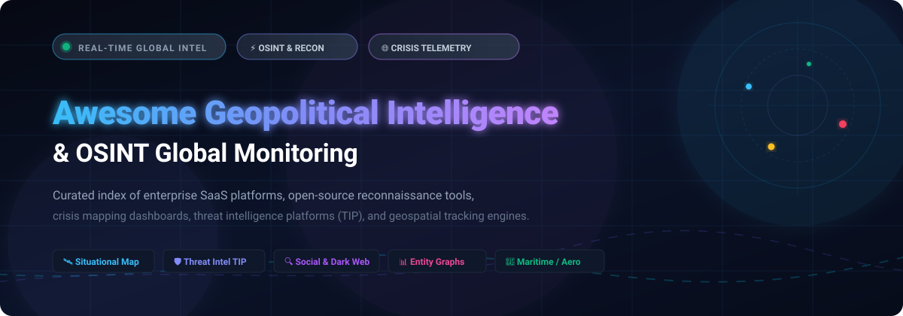

# 🌍 Awesome Geopolitical Intelligence & OSINT Global Monitoring

  

  
  
  
  

---

## 🔎 Curated Geopolitical Risk, Threat Intelligence & Open-Source Intelligence (OSINT) Ecosystem

> **An exhaustive, SEO-optimized directory of enterprise SaaS intelligence clouds, real-time crisis mapping dashboards, cyber threat intelligence platforms (TIP), automated attack surface recon tools, and entity link-analysis software.**

*Last updated: November 2026*

This repository indexes the world's most capable **commercial SaaS platforms** and **open-source GitHub projects** engineered for **Geopolitical Intelligence, Open-Source Intelligence (OSINT), and Global Crisis Situational Awareness**. Whether tracking geopolitical conflict zones (`koala73/worldmonitor`, `Ushahidi`), automating intelligence reconnaissance across billions of web entities (`Sherlock`, `Maigret`, `SpiderFoot`, `Amass`), centralizing structured cyber and physical threat indicators (`OpenCTI`, `MISP`), or investigating entity graphs and leaked documents (`Aleph`, `IntelOwl`), this collection serves intelligence analysts, defense researchers, investigative journalists, and corporate security teams eliminating expensive enterprise contracts.

---

## 📑 Table of Contents
- [📊 Sector Overview & Market Dynamics](#-sector-overview--market-dynamics)
- [☁️ SaaS/Hosted & Commercial Platforms](#️-saashosted--commercial-platforms)
- [💻 Open-Source GitHub Projects](#-open-source-github-projects)
- [📈 Star History](#-star-history)
- [🛠️ How to Contribute](#️-how-to-contribute)
- [⚠️ Disclaimer](#️-disclaimer)
- [💖 Support & Sponsorship](#-support--sponsorship)

---

## 📊 Sector Overview & Market Dynamics

The global Threat Intelligence, Geopolitical Risk & OSINT Analytics Software market is estimated at **$14.8B–$18.6B+ in 2026** (expanding at a ~16%–21% CAGR) as global supply chain disruptions, state-sponsored cyber warfare, and regional conflicts drive multi-source intelligence fusion. The sector is **moderately fragmented yet increasingly concentrated at the top tier**, where market leaders like Mastercard (Recorded Future) and Dataminr dominate multi-million enterprise accounts, while a vibrant, fast-growing long tail of specialized OSINT and open-source intelligence platforms actively serves investigative teams and researchers worldwide.

---

## ☁️ SaaS/Hosted & Commercial Platforms

*Sorted descending by company valuation / annual revenue scale.*

| 🏢 Platform | 📝 Description | 💰 Scale (Valuation / Revenue) | 🏷️ Starting Paid Tier | 🎁 Free Tier / Trial Limit |
| :--- | :--- | :--- | :--- | :--- |
| **[Recorded Future (Mastercard)](https://recordedfuture.com)** | 🌐 Enterprise Intelligence Cloud delivering real-time geopolitical, cyber, third-party, and brand threat intelligence powered by the Intelligence Graph. | **$2.65B Acquisition Valuation** (~$300M+ ARR; ~$28B+ Mastercard revenue) | **$40,000 / year** (entry-level single module package) | **Free Chrome Extension & Weekly Briefing** (Forever free Recorded Future Express browser extension for IOC risk scoring; 14-day guided enterprise evaluation) |
| **[Dataminr](https://dataminr.com)** | 🚨 Real-time AI event, crisis, and geopolitical risk detection platform (First Alert / Pulse) synthesizing public social, sensor, and dark-web signals. | **~$4.1B Peak Valuation** (~$1B+ total VC funding; ~$250M+ ARR) | **$15,000 / year** (~$500/user/month entry configuration) | **Free for Newsrooms & NGOs** (Free ongoing access via Dataminr for Good for accredited NGOs/journalists; 14-day guided corporate evaluation) |
| **[ZeroFox (Haveli Investments)](https://zerofox.com)** | 🛡️ External cybersecurity, executive protection, geopolitical physical-threat monitoring, and digital risk takedown SaaS platform. | **~$350M Take-Private Valuation** (~$220M+ annual revenue) | **$15,000 / year** (Foundation brand & digital risk protection bundle) | **15-Day Free Trial** (Time-limited evaluation license upon inquiry with complimentary external attack surface assessment) |
| **[Flashpoint](https://flashpoint.io)** | 🕵️ Finished threat intelligence, illicit-community monitoring, vulnerability intelligence, and physical/geopolitical risk platform (Echosec acquisition). | **~$500M–$750M Est. Valuation** (~$100M+ ARR; Audax Private Equity) | **$19,600 / year** (baseline Ignite user seat / single module subscription) | **14-Day Free Evaluation** (Guided sandbox trial workspace for enterprise security and intelligence teams upon request) |
| **[Janes](https://janes.com)** | ⚔️ Premier open-source defense, military capability, order-of-battle, geopolitical stability, and equipment intelligence platform. | **~$300M–$500M Est. Valuation** (Montagu Private Equity; >125-year defense heritage) | **$30,000 / year** (baseline enterprise / institutional defense database tier) | **14-Day Institutional Trial** (Guided evaluation access with sample geopolitical and military capability intelligence dossiers) |
| **[Intel 471](https://intel471.com)** | 🔒 Cybercrime, underground intelligence, geopolitical cyber-threat, and attack-surface monitoring SaaS serving enterprise and government teams. | **~$100M–$200M Est. Valuation** (~$40M+ ARR; Thoma Bravo backed) | **$49,000 / year** (TITAN entry-level credential/threat-hunting intelligence package) | **14-Day Guided Trial** (Proof-of-concept workspace evaluation with complimentary sample intelligence threat actor profiles) |
| **[Maltego](https://maltego.com)** | 🕸️ Industry-standard graphical link-analysis and OSINT data-mining platform connecting hundreds of commercial and open-source data transforms. | **~$100M–$200M Est. Valuation** (~$30M+ ARR; Charlesbank Capital Partners) | **€999 / year** (~$1,080/yr for Classic Pro seat; €7,500/yr for Advanced) | **Forever Free Plan** (Maltego Community/Basic Edition: 100% free forever desktop link-analysis graph capped at 24 results per transform run & 200 monthly credits) |
| **[Silobreaker](https://silobreaker.com)** | 📡 AI-powered geopolitical, cyber, and supply-chain intelligence platform aggregating millions of global news, dark-web, and government sources. | **~$50M–$100M Est. Valuation** (~$20M+ ARR; UK/EU intelligence software vendor) | **£70,000 / year** (~$88,000/yr baseline UK G-Cloud framework contract) | **14-Day to 30-Day Guided Trial** (Proof-of-concept evaluation license with weekly check-ins following product demo) |
| **[ShadowDragon](https://shadowdragon.io)** | 🎯 Digital footprinting, social-media monitoring (SocialNet), dark-web reconnaissance, and link-analysis suite for investigators and threat analysts. | **~$30M–$60M Est. Scale** (Profitable US OSINT & investigative software vendor) | **$5,000 / year** (SocialNet investigator baseline transform tier) | **14-Day Guided Evaluation** (Time-limited investigator evaluation license for law enforcement and corporate security teams) |
| **[SpiderFoot HX (Intel 471)](https://spiderfoot.net)** | 🕷️ Cloud-hosted automated OSINT reconnaissance and attack-surface monitoring SaaS running 200+ data-source modules with continuous alerts. | **Part of Intel 471** (Parent ARR ~$40M+; acquired SpiderFoot) | **$708 / year** ($59/month billed annually for Freelancer plan; 1 user, 15 scans/month) | **Forever Free Self-Hosted Edition / 7-Day HX Trial** (Open-source SpiderFoot MIT edition is 100% free forever with unlimited scans; historical 7-day HX cloud trial) |

---

## 💻 Open-Source GitHub Projects

*Sorted descending by GitHub stargazer count. All open-source repositories listed below are self-hostable with no licensing subscription fees.*

| 📦 Repository & Stars | 📜 License | 🎛️ Self-Hosted Freedom & Limits | 📌 Primary OSINT / Intelligence Domain & Features |
| :--- | :--- | :--- | :--- |
| **[sherlock-project/sherlock](https://github.com/sherlock-project/sherlock)**  | **MIT** | 100% Free Forever | 🔎 **Automated Username Reconnaissance**: Hunt down social media and forum accounts across 400+ international platforms with concurrent multi-threading. |
| **[koala73/worldmonitor](https://github.com/koala73/worldmonitor)**  | **GPL-3.0** | 100% Free Forever | 🗺️ **Real-Time Global Situational Awareness**: Interactive world intelligence map aggregating multi-source geopolitical crises, conflict telemetry, natural disasters, and flights. |
| **[soxoj/maigret](https://github.com/soxoj/maigret)**  | **MIT** | 100% Free Forever | 👤 **Dossier & Identity Graph Generator**: Collect name, photo, and profile footprints across 3,000+ sites with Tor/proxy support and comprehensive HTML report generation. |
| **[dgtlmoon/changedetection.io](https://github.com/dgtlmoon/changedetection.io)**  | **Apache-2.0** | 100% Free Forever | 👁️ **Automated Web Defacement & Intel Change Monitor**: Monitor government portals, sanction registries, adversary websites, and PDF documents for stealth changes. |
| **[archivebox/ArchiveBox](https://github.com/archivebox/ArchiveBox)**  | **MIT** | 100% Free Forever | 🗄️ **Self-Hosted Digital Evidence & OSINT Archiver**: Preserves web pages, video, PDF, screenshots, and metadata locally for immutable investigative chain of custody. |
| **[smicallef/spiderfoot](https://github.com/smicallef/spiderfoot)**  | **MIT** | 100% Free Forever | 🕸️ **Automated OSINT & Attack Surface Reconnaissance**: Runs 200+ modules targeting IPs, domains, CIDRs, emails, and phone numbers to map adversary attack surfaces. |
| **[Ciphey/Ciphey](https://github.com/Ciphey/Ciphey)**  | **MIT** | 100% Free Forever | 🔓 **Automated Cryptographic & Encoding Decryption**: AI/NLP-driven tool that automatically decrypts unknown encodings, hashes, and ciphers without knowing the key. |
| **[laramies/theHarvester](https://github.com/laramies/theHarvester)**  | **GPL-2.0** | 100% Free Forever | 📧 **External Surface & Email Gathering**: Scrapes search engines, Shodan, Censys, PGP key servers, and DNS for emails, subdomains, employee names, and open ports. |
| **[projectdiscovery/katana](https://github.com/projectdiscovery/katana)**  | **MIT** | 100% Free Forever | 🕷️ **Next-Gen Web Crawler & Endpoints Spider**: High-performance headless web crawler for discovering hidden endpoints, intelligence feeds, and unlinked web assets. |
| **[owasp-amass/amass](https://github.com/owasp-amass/amass)**  | **Apache-2.0** | 100% Free Forever | 🌐 **In-Depth Attack Surface Mapping**: In-depth network mapping and external asset discovery utilizing open-source information gathering and active DNS enumeration. |
| **[projectdiscovery/subfinder](https://github.com/projectdiscovery/subfinder)**  | **MIT** | 100% Free Forever | 📡 **Fast Passive Subdomain Reconnaissance**: Queries dozens of passive internet archives and certificate transparency logs without generating active traffic. |
| **[lockfale/osint-framework](https://github.com/lockfale/osint-framework)**  | **MIT** | 100% Free Forever | 🧭 **Comprehensive OSINT Taxonomy & Web Portal**: Interactive tree-based directory providing thousands of open-source research links categorized by artifact type. |
| **[blacklanternsecurity/bbot](https://github.com/blacklanternsecurity/bbot)**  | **GPL-3.0** | 100% Free Forever | ⚡ **Recursive Attack Surface & OSINT Scanner**: Modern modular reconnaissance engine executing recursive subdomain enum, port scanning, web crawling, and cloud leaks. |
| **[OpenCTI-Platform/opencti](https://github.com/OpenCTI-Platform/opencti)**  | **Apache-2.0** | 100% Free Forever | 🛡️ **Cyber & Geopolitical Threat Intelligence Platform**: Unified TIP built on STIX2 standards to structure, visualize, and correlate threat actor TTPs and campaigns. |
| **[MISP/MISP](https://github.com/MISP/MISP)**  | **GPL-3.0** | 100% Free Forever | 🤝 **Open Source Threat Sharing Platform**: International collaborative platform for sharing cyber security indicators, financial fraud data, and geopolitical IOCs. |
| **[lanmaster53/recon-ng](https://github.com/lanmaster53/recon-ng)**  | **GPL-3.0** | 100% Free Forever | 🧰 **Full-Featured Web Reconnaissance Framework**: Metasploit-style command-line framework with independent database storage and dozens of modular OSINT transforms. |
| **[intelowlproject/IntelOwl](https://github.com/intelowlproject/IntelOwl)**  | **AGPL-3.0** | 100% Free Forever | 🦉 **Threat Intelligence Orchestration & Triage**: Orchestrates 100+ threat intelligence feeds, malware analyzers, and OSINT APIs simultaneously via a single query. |
| **[alephdata/aleph](https://github.com/alephdata/aleph)**  | **GPL-3.0** | 100% Free Forever | 📚 **Investigative Entity & Document Graph Platform**: Built for investigative journalists (OCCRP) to search millions of leaked documents, court filings, and sanctions. |
| **[yeti-platform/yeti](https://github.com/yeti-platform/yeti)**  | **Apache-2.0** | 100% Free Forever | 🧊 **Your Everyday Threat Intelligence (Yeti)**: Organizes observables, indicators of compromise, TTPs, and knowledge of threats into a clean analyst-friendly web UI. |
| **[dfir-iris/iris-web](https://github.com/dfir-iris/iris-web)**  | **LGPL-3.0** | 100% Free Forever | 🚨 **Collaborative Incident Response & Case Management**: Case management platform tailored for CERTs and SOCs to track digital forensics investigations and compromised assets. |
| **[ushahidi/platform](https://github.com/ushahidi/platform)**  | **AGPL-3.0** | 100% Free Forever | 📍 **Crowdsourced Crisis Mapping & Human Rights Monitoring**: Pioneers real-time crowdsourcing of humanitarian crises, elections, disaster response, and conflict reports. |

---

## 📈 Star History

---

## 🛠️ How to Contribute

Contributions are warmly welcomed! Please review the contribution workflow:
1. 🍴 **Fork** this repository.
2. 🌿 Create a descriptive feature branch (`git checkout -b feature/add-new-intelligence-tool`).
3. 📝 Add factual entries linking to official platforms or verified repositories.
4. 🚀 Submit a detailed **Pull Request**.

---

## ⚠️ Disclaimer

This repository is maintained strictly for academic research, open-source intelligence education, threat defense, and humanitarian crisis monitoring. Always ensure proper authorization and comply with local laws and terms of service when conducting intelligence gathering or security evaluations.

---

## 💖 Support & Sponsorship

Thank you for visiting and supporting **Awesome Geopolitical Intelligence & OSINT Global Monitoring**! If this curated intelligence hub has assisted your security operations, investigative reporting, or academic research, please consider supporting the project:

- ⭐ **Star this repository** on GitHub to help other analysts discover it.
- 🍴 **Fork and share** with fellow threat researchers, investigative journalists, and colleagues.
- ☕ **Buy a coffee or sponsor ongoing maintenance**: Support development directly via the [GitHub Sponsor Dashboard](https://github.com/sponsors/ishandutta2007).
